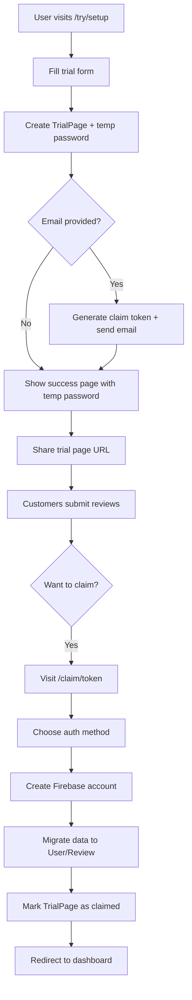
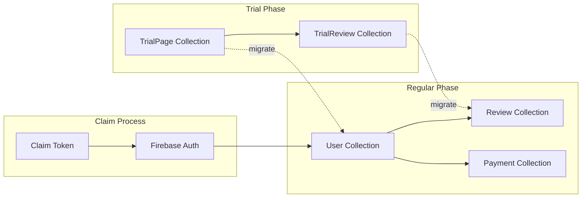

# Design Document: Trial Pages Feature

## Overview

The Trial Pages feature introduces a low-friction onboarding path for potential customers by allowing them to create temporary review pages without Firebase authentication. The system maintains strict separation between trial and regular user data while providing a seamless public-facing experience and a straightforward claim process to convert trial pages into full accounts.

### Key Design Principles

1. **Data Isolation**: Trial pages use separate MongoDB collections (TrialPage, TrialReview) to avoid coupling with existing User/Review schemas
2. **Minimal Friction**: Trial setup requires only username and optional email, with no password or authentication
3. **Unified Public Experience**: The existing `/[username]` route serves both trial and regular pages transparently
4. **Secure Claiming**: Token-based claim process with support for email/password and Google OAuth
5. **Abuse Prevention**: IP-based rate limiting prevents trial page spam

## Architecture

### High-Level Flow



### Data Flow Architecture



## Components and Interfaces

### 1. Database Models

#### TrialPage Schema (src/lib/models/server/trial-page.ts)

```typescript
{
  username: string (unique, indexed, lowercase, trimmed, max 100 chars)
  email?: string (optional, lowercase, trimmed)
  businessName: string (required, trimmed, max 100 chars)
  greeting?: string (optional, trimmed, max 100 chars)
  themeColor?: string (optional, trimmed, max 50 chars)
  imageUrl?: string (optional, trimmed)
  tempPassword: string (required, 6 chars, generated)
  contact?: {
    address?: string
    phone?: string
    whatsapp?: string
    facebook?: string
    twitter?: string
    instagram?: string
    tiktok?: string
    linkedin?: string
    mail?: string
  }
  claimToken?: string (optional, unique, 32+ chars)
  claimTokenExpiry?: Date (optional, 14 days from creation)
  claimed: boolean (default false)
  claimedBy?: ObjectId (optional, ref to User)
  claimedAt?: Date (optional)
  expired: boolean (default false)
  expiresAt: Date (required, 14 days from creation)
  createdAt: Date (default now)
  updatedAt: Date (default now)
  hits?: number (page view counter)
}
```

#### TrialReview Schema (src/lib/models/server/trial-review.ts)

```typescript
{
  page: ObjectId (required, ref to TrialPage)
  reviewer: {
    name: string (required, trimmed)
    email: string (required, trimmed, lowercase)
    code: string (required, trimmed, 6-digit verification code)
  }
  rating?: number (optional, 0-5)
  comment: string (required, trimmed, max 1000 chars)
  published: boolean (default true for trial pages)
  publishedAt: Date (set on completion)
  completedAt?: Date (set when code verified)
  createdAt: Date (default now)
  updatedAt: Date (default now)
}
```

#### IP Rate Limit Schema (src/lib/models/server/ip-rate-limit.ts)

```typescript
{
  ipAddress: string (required, indexed)
  attempts: number (default 1)
  firstAttemptAt: Date (default now)
  lastAttemptAt: Date (default now)
  expiresAt: Date (24 hours from first attempt, indexed with TTL)
}
```

### 2. Database Access Layer

#### src/lib/db/trial-page.ts

```typescript
// Check username uniqueness across User and TrialPage
async function isUsernameAvailable(username: string): Promise<boolean>

// Create new trial page
async function createTrialPage(data: TrialPageInput): Promise<TrialPage>

// Get trial page by username
async function getTrialPage(username: string): Promise<TrialPage | null>

// Get trial page with reviews (for public display)
async function getTrialPageWithReviews(username: string): Promise<TrialPageWithReviews | null>

// Get trial page by claim token
async function getTrialPageByToken(token: string): Promise<TrialPage | null>

// Mark trial page as claimed
async function markTrialPageClaimed(trialPageId: string, userId: string): Promise<void>

// Mark trial page as expired
async function markTrialPageExpired(trialPageId: string): Promise<void>

// Update trial page hit counter
async function updateTrialPageHit(username: string): Promise<void>
```

#### src/lib/db/trial-review.ts

```typescript
// Create trial review (initiated by sendCode)
async function createTrialReview(data: TrialReviewInput): Promise<TrialReview>

// Get trial review by ID and page
async function getTrialReview(reviewId: string, pageId: string): Promise<TrialReview | null>

// Get all reviews for a trial page
async function getTrialReviews(pageId: string): Promise<TrialReview[]>

// Confirm trial review with code
async function confirmTrialReview(reviewId: string, pageId: string, code: string): Promise<boolean>

// Migrate trial reviews to regular reviews
async function migrateTrialReviews(trialPageId: string, userId: string): Promise<void>
```

#### src/lib/db/ip-rate-limit.ts

```typescript
// Check if IP can create trial page
async function canCreateTrialPage(ipAddress: string): Promise<{ allowed: boolean; remainingAttempts: number }>

// Record trial page creation attempt
async function recordTrialPageAttempt(ipAddress: string): Promise<void>
```

### 3. Server Actions

#### src/app/actions/createTrialPage.ts

```typescript
"use server"

async function onCreateTrialPage(prevState: any, formData: FormData): Promise<{
  success?: boolean
  error?: string
  username?: string
  tempPassword?: string
}>
```

**Logic:**
1. Extract and validate form data (username, email, businessName, customization)
2. Get client IP address from headers
3. Check IP rate limit (max 3 per 24 hours)
4. Validate username uniqueness across User and TrialPage collections
5. Generate 6-character temp password (alphanumeric)
6. Create TrialPage record with 14-day expiration
7. If email provided, generate claim token and send email
8. Record IP attempt
9. Return success with username and temp password

#### src/app/actions/claimTrialPage.ts

```typescript
"use server"

async function onClaimTrialPage(prevState: any, formData: FormData): Promise<{
  success?: boolean
  error?: string
  redirectUrl?: string
}>
```

**Logic:**
1. Extract claim token, email, password (or Google OAuth token)
2. Validate claim token and check expiration
3. Get TrialPage by token
4. Check if already claimed
5. Create Firebase authentication account (email/password or Google)
6. Create User record with migrated TrialPage data
7. Migrate all TrialReview records to Review collection
8. Mark TrialPage as claimed (don't delete)
9. Create session cookie
10. Return success with redirect to dashboard

#### src/app/actions/sendTrialReviewCode.ts

```typescript
"use server"

async function onSendTrialReviewCode(prevState: any, formData: FormData): Promise<{
  success?: boolean
  error?: string
  id?: string
}>
```

**Logic:**
1. Extract trial page ID, reviewer name, email, rating, comment
2. Validate trial page exists and not expired
3. Check review limit (max 3)
4. Check reviewer hasn't already submitted
5. Generate 6-digit verification code
6. Create TrialReview record (published: true, publishedAt: now)
7. Send verification email
8. Return review ID

#### src/app/actions/confirmTrialReviewCode.ts

```typescript
"use server"

async function onConfirmTrialReviewCode(prevState: any, formData: FormData): Promise<{
  success?: boolean
  error?: string
}>
```

**Logic:**
1. Extract trial page ID, review ID, confirmation code
2. Validate code matches TrialReview record
3. Set completedAt timestamp
4. Return success

### 4. Pages and UI Components

#### src/app/try/setup/page.tsx

Trial page setup form with:
- Username input (with real-time availability check)
- Optional email input
- Business name input
- Optional greeting text
- Optional theme color picker
- Optional contact information fields
- Submit button

On success, redirect to `/try/success?username=[username]&password=[tempPassword]`

#### src/app/try/success/page.tsx

Success page displaying:
- Congratulations message
- Trial page URL: `quickrating.page/[username]`
- Temporary password (6 chars)
- Instructions to save credentials
- If email provided: "Check your email for claim link"
- Link to trial page
- Explanation of trial limitations (3 reviews, 14 days, auto-publish)

#### src/app/claim/[token]/page.tsx

Claim form with:
- Display trial page info (username, business name)
- Email input (pre-filled if trial had email, editable)
- Password input
- OR Google sign-in button
- Terms acceptance checkbox
- Submit button

On success, create Firebase account, migrate data, redirect to dashboard

#### src/app/[username]/page.tsx (Modified)

Update existing public page to:
1. Check User collection first
2. If not found, check TrialPage collection
3. If TrialPage found:
   - Check if expired, show banner if true
   - Render page with trial data
   - Show reviews from TrialReview collection
   - Display "Powered by QuickRating" (no subscription check)
4. If neither found, show 404

#### src/components/trialExpiredBanner.tsx

Banner component for expired trial pages:
- Yellow/orange warning banner at top
- Message: "This trial page expired on [date]. Claim it to continue using QuickRating."
- "Claim Page" button (if claim token exists)
- Dismissible

### 5. Services and Utilities

#### src/lib/services/trial.ts

```typescript
// Generate 6-character alphanumeric password
function generateTempPassword(): string

// Generate secure claim token (32+ chars)
function generateClaimToken(): string

// Get client IP from request headers
function getClientIP(request: Request): string

// Check if trial page is expired
function isTrialPageExpired(trialPage: TrialPage): boolean

// Validate username format (alphanumeric, hyphens, underscores, 3-30 chars)
function validateUsername(username: string): { valid: boolean; error?: string }
```

#### src/lib/services/migration.ts

```typescript
// Migrate TrialPage to User
async function migrateTrialPageToUser(trialPage: TrialPage, firebaseUid: string, email: string): Promise<User>

// Migrate TrialReviews to Reviews
async function migrateTrialReviewsToReviews(trialPageId: string, userId: string): Promise<void>
```

### 6. Email Templates

#### src/lib/models/server/email.ts (Add new function)

```typescript
async function sendTrialClaimEmail(email: string, businessName: string, claimUrl: string): Promise<boolean>
```

Email content:
- Subject: "Claim Your QuickRating Trial Page"
- Body: Personalized message with claim link, expiration notice (14 days), benefits of claiming

## Data Models

### Type Definitions

#### src/lib/models/client/trial-page.ts

```typescript
export type TrialPage = {
  _id?: string
  username: string
  email?: string
  businessName: string
  greeting?: string
  themeColor?: string
  imageUrl?: string
  tempPassword: string
  contact?: ContactInfo
  claimed: boolean
  expired: boolean
  expiresAt: Date
  createdAt?: Date
  hits?: number
}

export type TrialPageWithReviews = TrialPage & {
  reviews?: TrialReview[]
  maxedReviews?: boolean
}
```

#### src/lib/models/client/trial-review.ts

```typescript
export type TrialReview = {
  _id?: string
  page: string
  reviewer: {
    name: string
    email: string
  }
  rating?: number
  comment: string
  published: boolean
  publishedAt?: Date
  completedAt?: Date
}
```

## Error Handling

### Trial Page Creation Errors

- **Username taken**: "This username is already in use. Please choose another."
- **Rate limit exceeded**: "Too many trial pages created from your location. Please try again in 24 hours."
- **Invalid username format**: "Username must be 3-30 characters and contain only letters, numbers, hyphens, and underscores."
- **Database error**: "Unable to create trial page. Please try again."

### Review Submission Errors

- **Trial page expired**: "This trial page has expired. Please contact the business owner."
- **Review limit reached**: "This trial page has reached its maximum of 3 reviews."
- **Already reviewed**: "You have already submitted a review for this page."
- **Invalid email**: "Please enter a valid email address."
- **Code send failure**: "Unable to send verification code. Please try again."

### Claim Process Errors

- **Invalid token**: "This claim link is invalid or has expired."
- **Already claimed**: "This trial page has already been claimed."
- **Firebase auth error**: "Unable to create account. Please try again."
- **Migration error**: "Unable to complete claim process. Please contact support."
- **Email already in use**: "This email is already registered. Please use a different email or sign in."

## Testing Strategy

### Unit Tests

1. **Model Validation**
   - TrialPage schema validation (required fields, max lengths, format)
   - TrialReview schema validation
   - Username uniqueness check across collections

2. **Utility Functions**
   - Temp password generation (6 chars, alphanumeric)
   - Claim token generation (32+ chars, unique)
   - Username validation (format, length)
   - Expiration checking logic

3. **Rate Limiting**
   - IP rate limit enforcement (3 per 24 hours)
   - Rate limit reset after 24 hours
   - Multiple IPs don't interfere

### Integration Tests

1. **Trial Page Creation Flow**
   - Create trial page with minimal data
   - Create trial page with full customization
   - Create trial page with email (claim token generated)
   - Rate limit enforcement across multiple attempts

2. **Public Page Rendering**
   - Render regular user page
   - Render trial page (not expired)
   - Render expired trial page with banner
   - 404 for non-existent username

3. **Review Submission Flow**
   - Submit review to trial page
   - Verify auto-publish behavior
   - Enforce 3-review limit
   - Prevent duplicate reviews from same email

4. **Claim Process Flow**
   - Claim with email/password
   - Claim with Google OAuth
   - Claim with different email than trial
   - Data migration verification (TrialPage → User, TrialReview → Review)
   - TrialPage marked as claimed (not deleted)

### End-to-End Tests

1. **Complete Trial Journey**
   - Create trial page → Submit 3 reviews → Claim page → Verify dashboard access
   - Create trial page without email → Manually navigate to claim (no token)
   - Create trial page → Wait for expiration → Verify banner display

2. **Edge Cases**
   - Attempt to claim expired token
   - Attempt to claim already-claimed page
   - Create trial with username that becomes taken before claim
   - Submit review to expired trial page

## Security Considerations

### Authentication and Authorization

- Trial pages have NO authentication (by design)
- Claim tokens must be cryptographically secure (crypto.randomBytes)
- Claim tokens expire after 14 days
- Firebase authentication required for claim process
- Session cookies created after successful claim

### Data Protection

- Temp passwords are single-use (for reference only, not for login)
- Reviewer emails stored but not displayed publicly
- IP addresses stored only for rate limiting (24-hour TTL)
- Claim tokens stored hashed in database (optional enhancement)

### Abuse Prevention

- IP-based rate limiting (3 trial pages per 24 hours)
- Username validation prevents injection attacks
- Email validation prevents fake emails (using fakefilter)
- Review limit (3 per trial page)
- Trial expiration (14 days)
- Verification codes for review submission

### Input Validation

- All user inputs sanitized and validated
- MongoDB injection prevention (using Mongoose)
- XSS prevention (React escaping)
- CSRF protection (Next.js built-in)

## Performance Considerations

### Database Indexing

- TrialPage: username (unique), claimToken (unique), expiresAt
- TrialReview: page (ref), completedAt
- IPRateLimit: ipAddress, expiresAt (TTL index)

### Caching Strategy

- Public trial pages cached at CDN level (same as regular pages)
- Username availability checks cached client-side (5 seconds)
- Rate limit checks use in-memory cache when possible

### Cleanup Strategy

- Expired trial pages remain in database (marked as expired)
- Claimed trial pages remain in database (marked as claimed)
- IP rate limit records auto-deleted after 24 hours (MongoDB TTL index)
- Optional: Archive old trial pages after 90 days

## Migration Path

### Phase 1: Database Setup
1. Create TrialPage, TrialReview, IPRateLimit models
2. Add indexes
3. Test in development environment

### Phase 2: Core Functionality
1. Implement trial page creation flow
2. Implement public page rendering for trial pages
3. Implement review submission for trial pages

### Phase 3: Claim Process
1. Implement claim token generation and email
2. Implement claim page and form
3. Implement data migration logic
4. Test end-to-end claim flow

### Phase 4: Polish and Testing
1. Add expired trial banner
2. Implement rate limiting
3. Comprehensive testing
4. Documentation

## Open Questions and Future Enhancements

### Open Questions
- Should temp password be used for anything, or just for user reference?
- Should we allow claiming without email (manual token entry)?
- Should claimed trial pages be archived or kept indefinitely?

### Future Enhancements
- Trial page analytics (views, review conversion rate)
- Email reminders before trial expiration
- Ability to extend trial period
- Trial page templates/themes
- Social sharing features for trial pages
- QR code generation for trial pages
